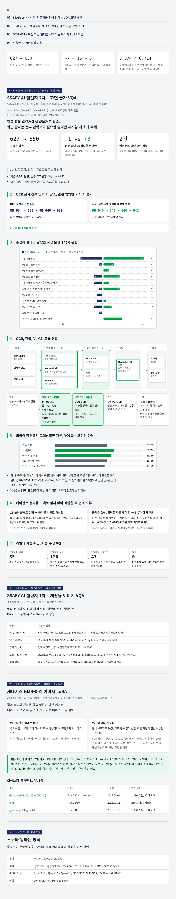

# 한범구 포트폴리오

NAVER 검색 플랫폼 음성번역 품질 평가·멀티모달 번역 연구 인턴 지원 포트폴리오

**[PDF로 보기 → naver.pdf](naver.pdf)**

## 프로젝트

| 번호 | 프로젝트 |
|---|---|
| 01 | SSAFY AI 챌린지 2차 · 사진 속 글자를 읽어 답하는 VQA 모델 개선 |
| 02 | SSAFY AI 챌린지 1차 · 재활용품 사진 질문에 답하는 VQA 모델 개선 |
| 03 | 제네시스 GMR-001 · 특정 차량 형태를 유지하는 이미지 LoRA 학습 |
| 04 | 사용한 도구와 작업 원칙 |
